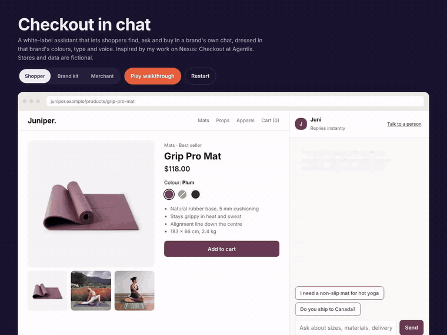
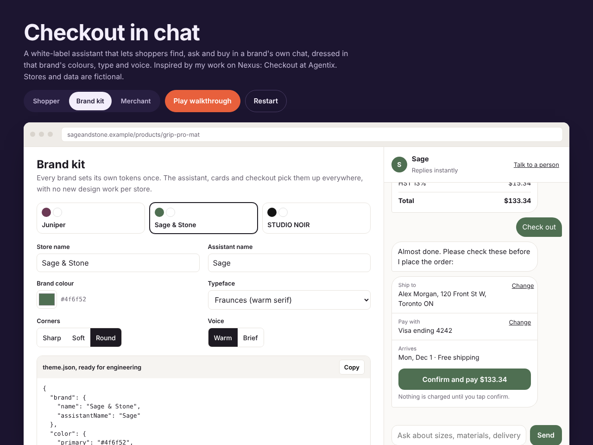
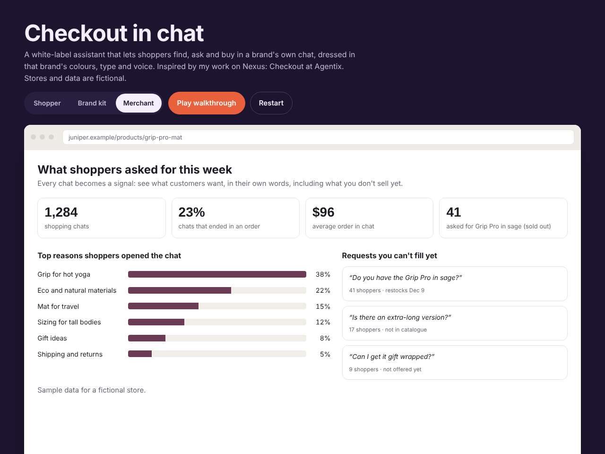

# Checkout in Chat

A white-label shopping assistant that lets shoppers find, ask and buy without leaving a brand's own chat. The same component runs three fictional stores, a yoga mat brand, a plant shop and a coat label, each dressed in its own colours, typeface, corner style, names and voice through a small set of design tokens.

**Live demo:** [nadiad12.github.io/checkout-in-chat](https://nadiad12.github.io/checkout-in-chat/)



## Why I built it

At Agentix, the team was focused on third-party checkout, where AI agents buy on a shopper's behalf. I kept asking what would happen if customers could check out directly in the merchant's own chat, so I built a prototype to show the team what it could feel like. This repo is a portfolio version of that idea, rebuilt from scratch with fictional stores and sample data.

## Three views

| Shopper | Brand kit | Merchant |
|---|---|---|
|  |  |  |
| The assistant recommends, recovers from a sold-out option, keeps the cart editable and asks for a final tap before paying. | A brand sets its tokens once and the whole assistant restyles live. Switching brand also switches the store and its products. The kit outputs `theme.json` for engineering. | Every chat becomes demand data, including what shoppers ask for that the store doesn't sell yet. |

## Three stores, one flow

| | Juniper | Sage & Stone | Studio Noir |
|---|---|---|---|
| Sells | Yoga mats | Houseplants | Winter coats |
| Shopper asks | A non-slip mat for hot yoga | A plant for a low-light bedroom | A warm black coat for winter |
| Sold out | Grip Pro in sage | Snake plant in the stone pot | Long coat in size S |
| Tokens | Plum · Inter · soft · warm | Green · Fraunces · round · warm | Black · Space Grotesk · sharp · brief |

The chat flow is written once. Each store only supplies its catalogue, copy and merchant data (`app/src/data.ts`) and its brand tokens (`themes/`).

## Design decisions

- **Nothing is bought without a tap.** The assistant prepares the order; the shopper confirms total, address and card before any charge.
- **It recovers instead of failing.** A sold-out option offers what ships today, the restock date, or a notification.
- **The cart stays editable in the conversation,** with the total always visible.
- **A person is one tap away.** "Talk to a person" stays in the header, and the team sees the full conversation.
- **One widget, any brand.** Colour, type, corners, names and voice are tokens, so a new store goes live by filling in its brand kit, not by redesigning screens.

## Brand tokens

Each brand is a small JSON file (see `themes/`):

```json
{
  "brand": { "name": "Sage & Stone", "assistantName": "Sage" },
  "color": { "primary": "#4f6f52", "onPrimary": "#ffffff" },
  "type": { "family": "fraunces" },
  "shape": { "radius": 22 },
  "voice": "warm"
}
```

| Token | What it controls |
|---|---|
| `color.primary` | Buttons, shopper messages, chips, avatar, highlights. Hover and tint shades are derived from it. |
| `color.onPrimary` | Text on the brand colour, picked automatically for contrast. |
| `type.family` | Typeface for the store and assistant. |
| `shape.radius` | Corner style for bubbles, cards, buttons and inputs (sharp, soft, round). |
| `voice` | `warm` for friendly full sentences, `brief` for short answers. |

## Built with

React 18 and TypeScript (strict), bundled with Vite. Designed and coded by me with Claude Code. Stores, products, people and numbers are fictional sample data. Plant and coat photos are from Unsplash.

```
app/src/
  App.tsx                  view tabs, browser frame, theme state, URL options
  theme.ts                 loads /themes/*.json, maps tokens to CSS variables, contrast check
  data.ts                  the three stores: products, store page, chat copy, merchant sample data
  chat/useConversation.tsx the conversation as a hook: typing delays, steps, side questions, cancellable timers
  chat/Chat.tsx            messages and cards rendered from live state (theme, quantity, payment)
  components/              Store, BrandKit, Merchant
```

The brand presets are read straight from the JSON files in `themes/`, so adding a brand is adding a file. The brand kit writes the same shape back out as `theme.json`.

URL options: `?brand=sage` or `?brand=noir` opens another store, `?to=cart` jumps to a step (`picks`, `soldout`, `cart`, `confirm`), and `?embed` hides the notes for embedding.

### Run it locally

```bash
cd app
npm install
npm run dev      # local dev server
npm run build    # type-checks, then builds to the repo root for GitHub Pages
```

---

Designed and coded by **Nadia Dadollahi** · [nadiadadollahi.framer.website](https://nadiadadollahi.framer.website)
