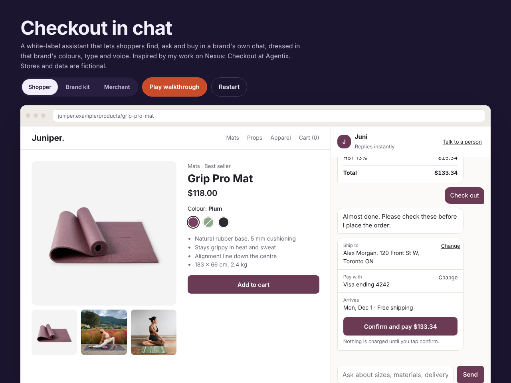

# Checkout in Chat

A white-label shopping assistant that lets shoppers find, ask and buy without leaving a brand's own chat. Each brand dresses it in its own colours, typeface, corner style, names and voice through a small set of design tokens.


**Live demo:** open `index.html` in any browser, or turn on GitHub Pages for this repo (Settings → Pages → Deploy from branch → `main` / root).

## Why I built it

At Agentix, the team was focused on third-party checkout, where AI agents buy on a shopper's behalf. I kept asking what would happen if customers could check out directly in the merchant's own chat, so I built a prototype to show the team what it could feel like. This repo is a portfolio version of that idea, rebuilt from scratch with a fictional store and sample data.

## Three views

| Shopper | Brand kit | Merchant |
|---|---|---|
|  |  |  |
| The assistant recommends, recovers from a sold-out colour, keeps the cart editable and asks for a final tap before paying. | A brand sets its tokens once and the whole assistant restyles live. The kit outputs `theme.json` for engineering. | Every chat becomes demand data, including what shoppers ask for that the store doesn't sell yet. |

## Design decisions

- **Nothing is bought without a tap.** The assistant prepares the order; the shopper confirms total, address and card before any charge.
- **It recovers instead of failing.** A sold-out colour offers what ships today, the restock date, or a notification.
- **The cart stays editable in the conversation,** with the total always visible.
- **A person is one tap away.** "Talk to a person" stays in the header, and the team sees the full conversation.
- **One widget, any brand.** Colour, type, corners, names and voice are tokens, so a new store goes live by filling in its brand kit, not by redesigning screens.

## Brand tokens

Each brand is a small JSON file (see `themes/`):

```json
{
  "brand": { "name": "Sage & Stone", "assistantName": "Sage" },
  "color": { "primary": "#4f6f52", "onPrimary": "#ffffff" },
  "type": { "family": "fraunces" },
  "shape": { "radius": 22 },
  "voice": "warm"
}
```

| Token | What it controls |
|---|---|
| `color.primary` | Buttons, shopper messages, chips, avatar, highlights. Hover and tint shades are derived from it. |
| `color.onPrimary` | Text on the brand colour, picked automatically for contrast. |
| `type.family` | Typeface for the store and assistant. |
| `shape.radius` | Corner style for bubbles, cards, buttons and inputs (sharp, soft, round). |
| `voice` | `warm` for friendly full sentences, `brief` for short answers. |

## Built with

Plain HTML, CSS and JavaScript in a single file, no build step. Prototyped with AI-assisted coding. Store, products, people and numbers are fictional sample data.

---

Designed by **Nadia Dadollahi** · [nadiadadollahi.framer.website](https://nadiadadollahi.framer.website)
